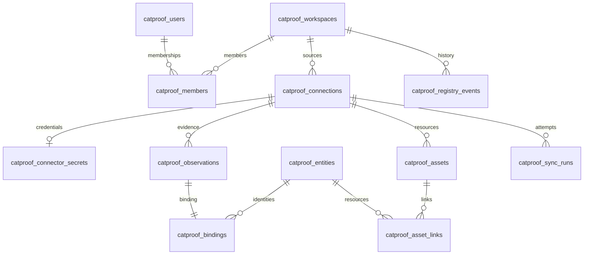

# PostgreSQL schema and migration review

All persistent application state now lives in PostgreSQL. Docker Compose runs
PostgreSQL 17 for development and a separate disposable PostgreSQL 17 service for
tests. SQLite is used only to read old files/blobs during compatibility imports.

## Why the previous split existed

The hosted implementation reused the original local registry by serializing its
SQLite database into a PostgreSQL BYTEA column for each workspace. This avoided an
initial repository rewrite but made every change rewrite the whole inventory,
prevented relational foreign keys between credentials and connections, and left
schema changes spread across constructors and request handlers. These observations
come from the code at `8224667`; no Entire checkpoint intent was available.

## Review findings and implemented decisions

| Finding | Resolution |
| --- | --- |
| Whole-registry SQLite blobs, duplicated legacy snapshot authority | Inventory is stored as PostgreSQL rows; both blob tables are retired after transactional import. |
| Constructor/lazy DDL without a durable schema revision | Alembic is the only schema initialization/upgrade path; startup checks the revision. |
| Credential rows cannot reference connections inside blobs | Composite foreign key from `(registry_id, connection_id)` to `(tenant_id, id)`. |
| Application-only tenant boundaries for inventory | Tenant-scoped primary/foreign keys plus PostgreSQL row-level security. |
| Missing relationship and expiry indexes | Indexes cover connection evidence, bindings, asset links, history, membership, session expiry, invites and devices. |
| Unconstrained lifecycle/review/flag values | Database checks enforce supported enums, flags, nonnegative counts and device sequences. |
| Reads serialized behind inventory writes | Read-only repeatable-read transactions; only writes acquire registry advisory locks. |
| SQLite tests cannot establish PostgreSQL behavior | Database-backed tests use disposable PostgreSQL schemas, including HTTP tests. |
| A direct JSONB uniqueness index rejects valid large connector scopes | A SHA-256 configuration digest keeps the unique scope index bounded, including 100-principal Entra scopes. |
| Asset links require one query per asset | Snapshot reads load all visible asset links in one query. |
| In-flight old-password login can outlive recovery | Login, password change and recovery hold the same user-row lock through session issuance/revocation and commit. |
| Unsupported blob schema can be discarded during import | Blob and file imports share strict table/object/column validation, including empty tables, before copying rows or retiring snapshots. |
| Observations can exist without canonical bindings | Imports reject missing bindings; h0005 adds a deferred reverse composite foreign key to require a binding at commit. |
| Shared databases can have another application's Alembic history | CatProof uses `catproof_alembic_version` and adopts only recognized prior CatProof history. |
| Latest sync history scans and sorts all retained rows | h0005 indexes `(tenant_id, completed_at DESC, sequence DESC)` for the latest-100 query. |
| Standalone imports can restore retired sources after h0006 has run | File imports reject retired connection IDs or origins before copying any rows, preserving the original backup. |

Canonical agent decisions remain separate from provider observations. Provider
payloads and configurations use JSONB; identifiers, relationships, freshness flags,
and timestamps have explicit columns. Inventory timestamps use TIMESTAMPTZ. Existing
authentication expiry columns retain epoch seconds to preserve session behavior.



Every inventory relation includes `tenant_id`. Relationships include that column
in their foreign keys, so two tenants may retain identical imported IDs without
colliding or linking across tenants. The old standalone product's tables are also
PostgreSQL tables (`catproof_agents`, `catproof_events`, `catproof_metadata`), separate
from the canonical registry. New tables are prefixed to avoid unrelated application
tables in a shared database.

The observation-to-binding relationship is mandatory in both directions. The
binding primary key allows at most one binding; a deferred reverse foreign key
requires at least one at transaction commit. Ingest may insert the observation
before its binding within the same transaction. Rebinding updates the existing
binding, and deleting a pair requires deleting both rows in one transaction.

## Tenant isolation and transactions

Inventory connections explicitly assume the `catproof_inventory` NOLOGIN,
NOSUPERUSER, NOBYPASSRLS role, then set the authenticated registry context. Hosted
requests use transaction-local role/context settings. Policies enforce both visible
and writable rows. This matters because PostgreSQL superusers bypass row security;
merely enabling RLS while using the Compose owner would not enforce isolation.
See [PostgreSQL row security](https://www.postgresql.org/docs/17/ddl-rowsecurity.html).

Account/security tables still use explicit authorized registry/user predicates.
RLS is an additional guard for inventory, not an authentication system or protection
against a compromised database administrator. No request body chooses the registry
context. The runtime role has DML access only to CatProof tables, not DDL privileges,
Alembic metadata, or unrelated tables.

Writes, encrypted credential rotation, and audit events share a PostgreSQL commit
boundary. Nested registry operations use savepoints. Fetches happen outside these
transactions, and authorization/generation checks run again before application.
Reads use repeatable-read snapshots and do not acquire the writer advisory lock.

Password login and password changes acquire `FOR NO KEY UPDATE` on the user row
before checking the password and hold it through session issuance and commit.
Recovery uses the same row lock while changing the hash and revoking sessions.
If login wins the lock, recovery revokes its session; if recovery wins, login
checks the new hash. Expired-session cleanup during issuance is scoped to the
same user so it does not introduce cross-user lock dependencies.

## Initialize and operate

```sh
# Docker and npm start run start.py: migrate first, then serve.
docker compose up --build -d --wait

# Explicit operator commands use DATABASE_URL, never a checked-in URL.
python database.py upgrade
python database.py current
python database.py check

# Alembic equivalents and creating the next explicit revision:
alembic -n hosted upgrade head
alembic -n hosted current
alembic -n hosted revision -m "describe schema change"
```

`h0001` adopts the previously unversioned account schema and performs the historical
one-time membership backfill. `h0002` creates relational inventory, validates and
imports existing snapshots, adds constraints/indexes/RLS, and retires the blob tables.
`h0003` adds digest-based connection scope uniqueness and replaces the direct JSONB
constraint from the early local h0002 installation. New installations defer that
index until after import so valid large legacy configurations can migrate.
`h0004` initializes or adopts main's password recovery table, preserving token
hashes, absolute expiries and consumed-grant state. Recovery constructors no longer
create tables; recovery data remains in the account/security schema.
`h0005` requires a canonical binding for every observation and adds the latest-sync
history index. An existing orphan observation aborts the upgrade without deleting
data or advancing the revision. Investigate against the backup and restore the
intended binding explicitly; do not infer a canonical entity automatically.
`h0006` adapts upstream retired-source cleanup to PostgreSQL rows, preserving
manual and independently linked inventory and deleting matching credentials in
the same transaction. It retains earlier cleanup receipts and records a count-only
`retired-source-postgres-v1` receipt; startup only reads it.
Together they also initialize an empty database. Upgrades run in one transaction under a
PostgreSQL advisory lock, including concurrent startup from separate processes.
Do not stamp an existing database to head without running the migration.

Alembic now records revisions in `catproof_alembic_version`. Under the migration
lock, an installation with the old generic `alembic_version`, a single recognized
CatProof revision (`h0001`–`h0004`), and CatProof account tables adopts that history
transactionally by renaming the table. Fresh installations leave another
application's generic history untouched. Unknown old revisions alongside existing
CatProof inventory fail closed for operator investigation. Once the namespaced
table exists, it is authoritative. Upgrade before starting the new application;
runtime checks and standalone imports require the namespaced current revision.

The migration owner needs schema DDL privileges and permission to create/grant the
NOLOGIN inventory role. Compose's database owner has those permissions. On a managed
host, have the DBA provision `catproof_inventory` and grant membership/admin rights
to the migration owner before upgrading if CREATEROLE is unavailable. Normal app
requests do not create roles or tables. `python hosted_app.py` requires an already
migrated database; `python start.py` runs the upgrade first.

Revisions are explicit and reviewed; there is no ORM metadata/autogeneration source.
Use Alembic operations or SQL in the new revision and test a populated upgrade path.
See the [Alembic tutorial](https://alembic.sqlalchemy.org/en/latest/tutorial.html).

## Upgrade existing data

1. Stop every old application writer. Old and new binaries must not overlap.
2. Take a PostgreSQL backup and retain the old application revision. Back up the
   connector encryption keys separately; the migration does not change ciphertext.
3. Run the new version's `python database.py upgrade` and `check`.
4. Verify accounts, inventory IDs, links, history and credential presence, then start
   the new application. Compare counts with the backup before relying on the result.

The importer reads each old SQLite blob without modifying it. It preserves canonical
IDs, source/asset IDs, explicit links, flags, audit sequence values, and sync history.
The newer legacy snapshot wins if the two historical legacy copies differ in time.
Per-table counts and PostgreSQL constraints validate the import. Corruption, an
invalid foreign key, missing canonical binding, conflicting connection scope, or
unsupported legacy tables, views, triggers or columns (even on empty tables)
abort the transaction. No partially imported registry becomes available.

This is a forward-only data migration. Rollback means restoring the backup with the
old application, not running destructive downgrade SQL. The application never falls
back to SQLite when PostgreSQL is unavailable. Standalone SQLite files use the
explicit import procedure below; startup never discovers or uploads them.

## Import a standalone SQLite file

`database.py import-sqlite` imports an offline backup into an **existing, empty
target registry**. It reads the source without changing it, copies rows in one
PostgreSQL transaction, validates counts and constraints, and records a source
fingerprint in `catproof_migrations`. Repeating the same file/target returns
`already_imported` without overwriting subsequent edits. A different file cannot
be merged into an occupied target. Unknown tables/columns, mixed schemas, invalid
relationships, or corrupt data cause failure rather than partial import.

Federated backups containing an explicitly retired connection ID or origin are
also rejected, including paused connections. The importer checks the same IDs
and origin fingerprints as the retirement migration before inserting any rows;
it leaves the source, destination inventory and import markers unchanged. Keep
the original backup and review retirement cleanup before preparing a separate
importable copy. Re-running `upgrade` alone will not clean up a later file import:
`h0006` runs only once, before the importer accepts the destination schema.

Supported source layouts:

- **Federated registry:** preserves connections and credential references,
  canonical/manual/archived agents, ownership, lifecycle, reviews, notes,
  observations, bindings, related assets and links, audit IDs/actors, sync history
  and previous migration markers. Older optional columns receive their existing
  compatibility defaults. Audit sequences advance beyond imported IDs.
- **Earlier inventory product:** preserves all namespaces, agent IDs, payloads,
  ownership/review/notes, presence, source metadata and audit history in
  `catproof_agents`, `catproof_events` and `catproof_metadata`. Use `product_app.py`
  with the same namespace to read this data. This preserves the product schema;
  it does not convert product records into the hosted canonical inventory.

1. Stop the old SQLite application and retain its application revision. Create a
   consistent SQLite backup, for example with SQLite's `.backup` command. Do not
   copy only the main file of an active WAL database. The importer rejects sibling
   `-wal`, `-shm` or `-journal` files; do not delete these to bypass the check.
2. Back up the destination PostgreSQL database. Provision an empty registry before
   stopping destination writers. For standalone interfaces use the initialized
   `legacy` registry; for hosted inventory create a personal account/registry and
   use its exact registry ID from `/api/me`. Importing into `legacy` does not assign
   that inventory to a newly created personal account.
3. Set `DATABASE_URL` using the operator connection and initialize/upgrade the
   destination. Run with Python 3.11+ and installed `requirements.txt`:

   ```sh
   python database.py upgrade
   python database.py import-sqlite /absolute/path/backup.sqlite3 --registry-id legacy
   ```

   For a running Compose database, stop the app and mount the backup read-only
   into a one-off container. Replace the source path and target registry ID:

   ```sh
   docker compose stop app
   docker compose run --build --rm --no-deps app python database.py upgrade
   docker compose run --build --rm --no-deps -v /absolute/path/backup.sqlite3:/imports/backup.sqlite3:ro app python database.py import-sqlite /imports/backup.sqlite3 --registry-id TARGET_REGISTRY_ID
   docker compose up --build -d --wait
   ```

4. Inspect the reported per-table counts and preserved IDs/decisions/history before
   enabling sync or retiring the old installation. No provider is contacted during
   import. Existing paused connections remain paused. Configure authorized provider
   credentials separately: standalone SQLite databases contain environment references,
   not the hosted encrypted credential store. No accounts, memberships or secrets are
   invented or copied from the operator's environment.

The import takes registry and inventory-table locks to protect empty-target checks
and shared audit sequences. Run it during a maintenance window with destination
writers stopped. Use the migration/operator database role, including table DML and
sequence UPDATE permission; the normal inventory role intentionally lacks sequence
reset permission. Sequence counters may advance on rollback, but inventory and the
import marker commit together. Retrying an unchanged successful import is safe.

The old `federation_app.py --legacy-db` option remains an annotation-only bridge
from product rows to existing canonical observations. It is not this full import.

## Validation and remaining limits

Migration tests cover fresh/repeated initialization, unversioned populated adoption,
identical IDs in two registries, preservation of encrypted credential rows, failed
import rollback, RLS visibility/write enforcement, foreign keys, unknown revision
rejection, and concurrent startup. The full suite also exercises authorization,
commit failures, sync races, restart persistence and the actual collector over TLS.
Final-review regressions cover large configurations on creation/import/upgrade,
deferred sync generations, queued connection changes, and batched asset-link reads.
Standalone import tests cover both schemas, source preservation, retries/concurrency,
occupied targets, tenant selection, sequence preservation, older columns, malformed
data rollback and sanitized CLI failures, including a non-superuser operator.
They also cover rejection of retired IDs and origins after cleanup has completed,
paused sources, source preservation, empty targets and CLI retry after a repeat upgrade.
Database-review regressions additionally cover recovery racing login/password
change, unsupported blob schema rollback, missing bindings in both import paths,
binding enforcement at commit, orphaned populated upgrade rejection, old revision
table adoption, coexistence with foreign migration history, and index use for
20,000 synthetic sync runs under the inventory role and RLS.
Run `docker compose --profile test run --build --rm tests`.

This removes the 25 MB blob cap and whole-inventory database rewrites. It does not
establish production scale: the inventory API still materializes a full registry,
provider reads have bounded request budgets, audit history has no retention job,
and sync scheduling is request-driven rather than a durable queue. Backup restoration,
capacity, catalog pagination and job durability remain operational work before a
large deployment. Audit tables are ordinary database records, not immutable storage.

## Website lead capture (h0007)

An additive migration creates `catproof_website_leads`, separate from accounts and tenant inventory, with a composite email/purpose key, consent timestamp, policy version, and bounded contact fields. No existing data is rewritten. Inventory roles are not granted access; no public list endpoint exists. Startup applies the revision in the existing migration transaction. See WEBSITE_LEADS.md for operator export/deletion.
